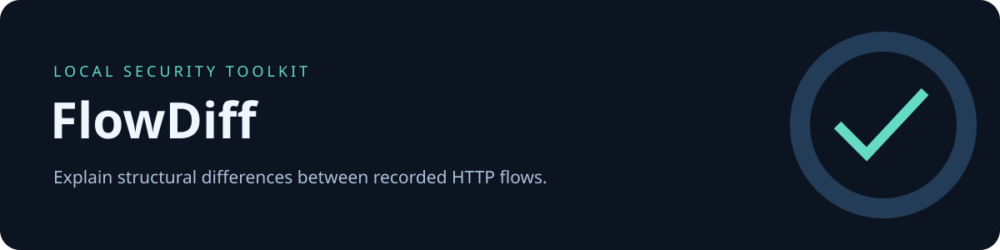

# FlowDiff

**Explain structural differences between recorded HTTP flows.**

Python 3.10+ · Standard-library runtime · Offline by design · MIT · v0.1.0

[العربية](README.ar.md) · [Contributing](CONTRIBUTING.md) · [Security](SECURITY.md) · [Changelog](CHANGELOG.md)

## Why this exists

A focused, inspectable tool for a repeatable security workflow. Reports retain evidence and uncertainty, so an analyst can reproduce the observation without trusting an automatic vulnerability verdict.

## Capabilities

- Compare HTTP response statuses and request/response header **names**.
- Compute added/removed JSON fields and changed JSON types with RFC 6901 pointers.
- Keep repeated route occurrences and label unmatched captures.
- Pair by normalized route by default; opt into index pairing for different endpoints.
- Omit scalar values and body text from all report formats.

## Quick start

From this project's directory, no installation or external runtime dependencies are needed:

```bash
python -m flowdiff examples/before.har examples/after.har -o reports/diff.html
```

Open the HTML report in a browser, or use a `.json` output path for structured data. Omit `-o` to print JSON to stdout.

Another example:

```bash
python -m flowdiff examples/before.har examples/after.har --pair-by-index -o reports/diff.json
```

## Install

```bash
python3 -m venv .venv
. .venv/bin/activate
python -m pip install .
flowdiff --help
```

Packaging uses setuptools; installing may fetch build tools. The analysis command itself has no network functionality. The source form `python -m flowdiff` works without pip from this directory.

### Android / Termux

```bash
pkg install python git
git clone https://github.com/khdertaysh1/khdertaysh1.git
cd khdertaysh1/projects/flowdiff
python -m flowdiff examples/before.har examples/after.har -o reports/diff.html
```

Termux installation requires a network connection. Runtime analysis is local. Android compatibility follows from the standard-library implementation; device testing has not been performed.

## Read the demo

The demo compares a profile response with a 401 error response. It reports removed `/account` fields and an added `/error` field. These are structural observations. It deliberately does not decide which endpoint has correct authorization.

[View the synthetic JSON result](docs/demo.json) · [Download the self-contained HTML demo](docs/demo.html)

## Inputs and outputs

Use `python -m flowdiff --help` for the full command interface. Inputs are local files; paths containing spaces should be quoted. Reports are deterministic for identical inputs and options. Exit code **0** means analysis completed, not that the input is secure. Exit code **2** means invalid arguments or an input/output error. Reports can replace an existing output file, but cannot overwrite a specified input.

The `examples/` directory contains only synthetic, documentation-only data. Canary strings named `CANARY_*` test omission of common secret-bearing values. No real target credentials are included.


## Evidence limits and privacy

- Scalar values are never compared/exported: `true` to `false`, 1 to 2, and token changes are intentionally outside scope.
- Arrays compare by numeric index, so reordering can create noisy results.
- Only recorded JSON bodies with a MIME type containing `json` are analyzed; forms, multipart and binary bodies are omitted.
- Missing or empty capture text is labeled `not_captured_or_empty`, not treated as proof of an empty server response.
- Route matching ignores query values. `--pair-by-index` depends on analyst-verified ordering.

Reports are **not guaranteed anonymous**. Paths, property names, source filenames and IP addresses may reveal context. Review output before publishing. Keep real HARs and logs outside public repositories.

## Development

```bash
python -m unittest discover -s tests -v
python -m compileall -q flowdiff
```

The repository workflow tests Python 3.10, 3.12 and 3.13. Current local verification is recorded in the toolkit catalog; a configured workflow does not by itself mean remote checks passed.

## License

MIT © 2026 Khedr Tayshoori. See [LICENSE](LICENSE).
