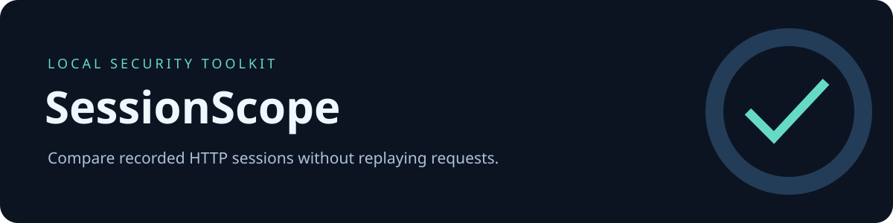

# SessionScope

**Compare recorded HTTP sessions without replaying requests.**

Python 3.10+ · Standard-library runtime · Offline by design · MIT · v0.1.0

[العربية](README.ar.md) · [Contributing](CONTRIBUTING.md) · [Security](SECURITY.md) · [Changelog](CHANGELOG.md)

## Why this exists

A focused, inspectable tool for a repeatable security workflow. Reports retain evidence and uncertainty, so an analyst can reproduce the observation without trusting an automatic vulnerability verdict.

## Capabilities

- Compare routes by HTTP method, normalized authority/path and query **names**.
- Preserve repeated request occurrences rather than silently dropping duplicates.
- Inventory authorization-header presence, cookie names, and Set-Cookie security attributes.
- Optionally check an exact response marker, including base64 HAR content.
- Export local JSON or self-contained HTML; do not replay requests.

## Quick start

From this project's directory, no installation or external runtime dependencies are needed:

```bash
python -m sessionscope examples/before.har examples/after.har -o reports/logout.html
```

Open the HTML report in a browser, or use a `.json` output path for structured data. Omit `-o` to print JSON to stdout.

Another example:

```bash
python -m sessionscope examples/before.har examples/persistent.har --marker LAB_PROTECTED_MARKER -o reports/persistent.json
```

## Install

```bash
python3 -m venv .venv
. .venv/bin/activate
python -m pip install .
sessionscope --help
```

Packaging uses setuptools; installing may fetch build tools. The analysis command itself has no network functionality. The source form `python -m sessionscope` works without pip from this directory.

### Android / Termux

```bash
pkg install python git
git clone https://github.com/khdertaysh1/khdertaysh1.git
cd khdertaysh1/projects/sessionscope
python -m sessionscope examples/before.har examples/after.har -o reports/logout.html
```

Termux installation requires a network connection. Runtime analysis is local. Android compatibility follows from the standard-library implementation; device testing has not been performed.

## Read the demo

The denial demo reports `access_denied_observed`. The persistent demo reports `protected_marker_persists_review_capture_and_cache` only when the marker appears in the baseline and a 2xx after-capture response. Neither label establishes a vulnerability. A 2xx page can be a login shell, a cached response, or public content.

[View the synthetic JSON result](docs/demo.json) · [Download the self-contained HTML demo](docs/demo.html)

## Inputs and outputs

Use `python -m sessionscope --help` for the full command interface. Inputs are local files; paths containing spaces should be quoted. Reports are deterministic for identical inputs and options. Exit code **0** means analysis completed, not that the input is secure. Exit code **2** means invalid arguments or an input/output error. Reports can replace an existing output file, but cannot overwrite a specified input.

The `examples/` directory contains only synthetic, documentation-only data. Canary strings named `CANARY_*` test omission of common secret-bearing values. No real target credentials are included.


## Evidence limits and privacy

- HAR files are observations. They cannot establish logout completion, request freshness or correct capture timing.
- Matching ignores query values. Two requests to different object IDs in the query can be grouped. Inspect the source captures privately.
- A marker should be a non-secret test label unique to authenticated content. The marker itself is not exported.
- Set-Cookie parsing handles separate HAR header records; folded/malformed headers, browser cookie jars and Expires semantics are not fully modeled.
- Redirects are reported for review; authentication decisions are not inferred from Location.

Reports are **not guaranteed anonymous**. Paths, property names, source filenames and IP addresses may reveal context. Review output before publishing. Keep real HARs and logs outside public repositories.

## Development

```bash
python -m unittest discover -s tests -v
python -m compileall -q sessionscope
```

The repository workflow tests Python 3.10, 3.12 and 3.13. Current local verification is recorded in the toolkit catalog; a configured workflow does not by itself mean remote checks passed.

## License

MIT © 2026 Khedr Tayshoori. See [LICENSE](LICENSE).
